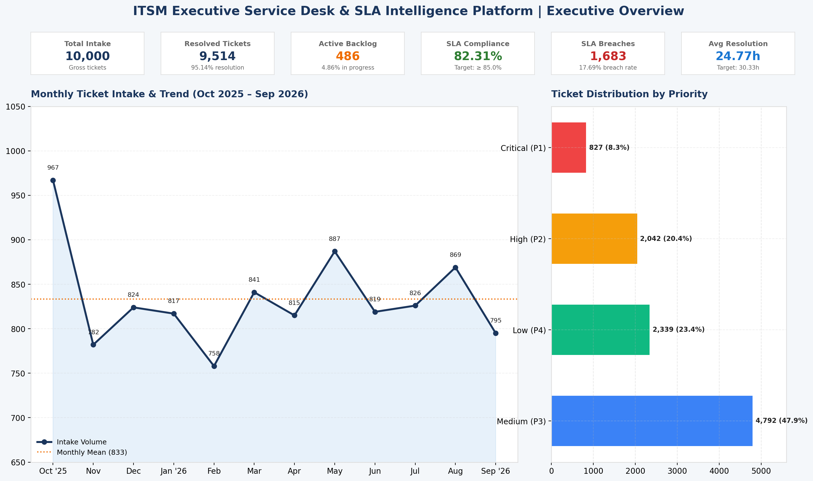
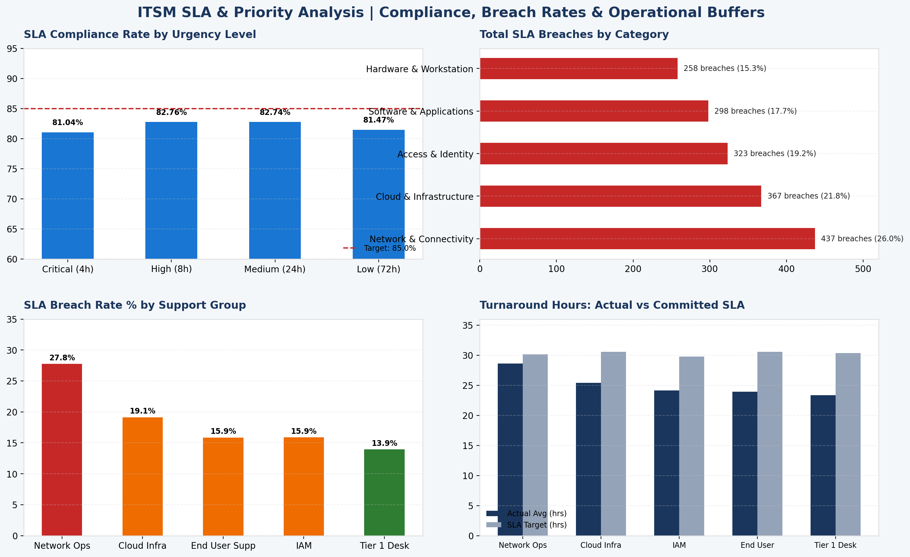
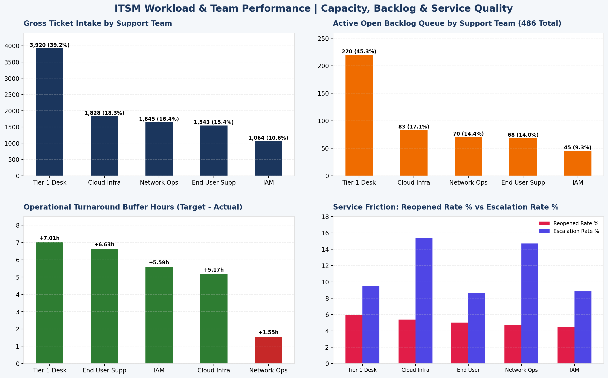
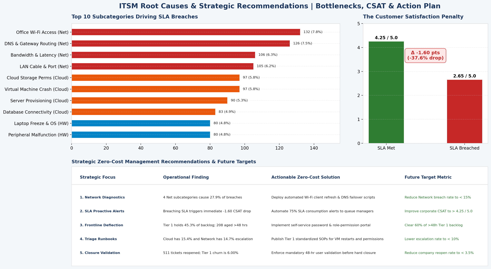
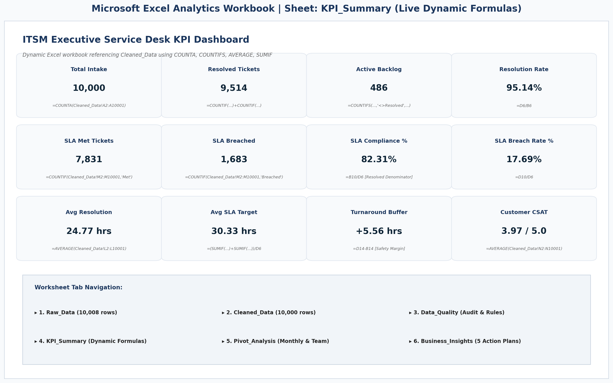
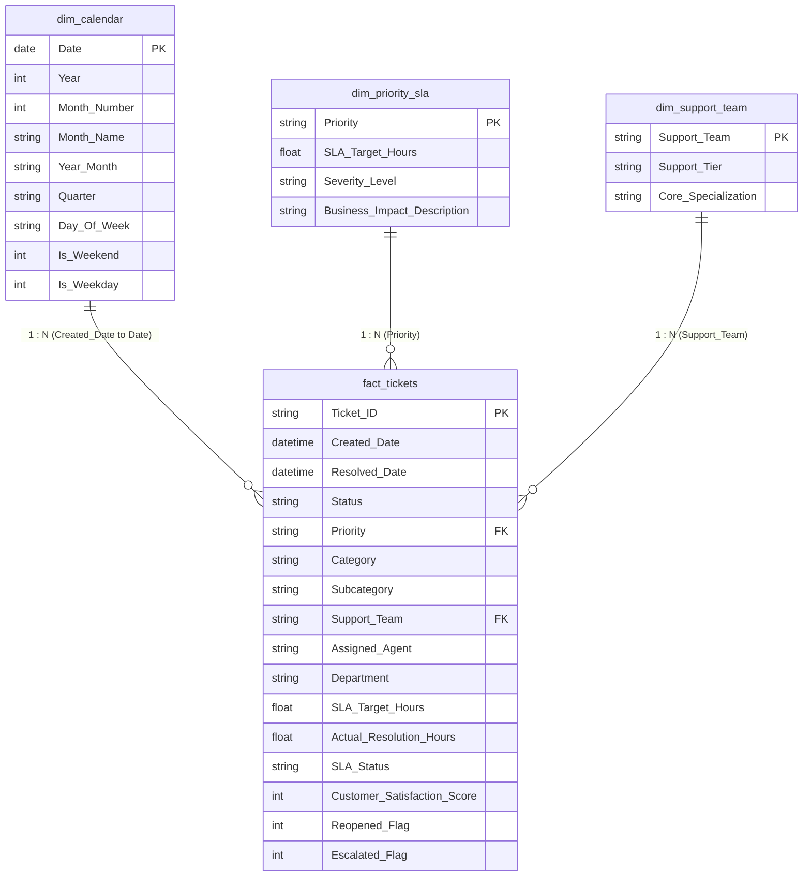

# Enterprise IT Service Desk & SLA Intelligence Platform

[](https://www.sqlite.org/)
[](https://www.tableau.com/)
[](https://www.microsoft.com/excel)
[](#4-data-model--star-schema)
[](#)

An enterprise-grade, end-to-end IT service desk analytics platform developed for IT service delivery leadership. Designed to address the core business question:

> **"How can management improve SLA compliance and resolution efficiency without increasing support costs?"**

---

## Executive Dashboard Suite

### 1. Executive Overview Dashboard

*High-level executive pulse check monitoring intake volume, resolution rate, contractual compliance, monthly seasonality, and priority distribution.*

### 2. SLA & Priority Analysis Dashboard

*Deep-dive into SLA compliance across urgency levels (P1–P4), category breach volumes, team breach rates, and turnaround buffers.*

### 3. Workload & Team Performance Dashboard

*Operational queue capacity, active open backlog distribution, group turnaround speed, and quality churn (reopens vs. escalations).*

### 4. Root Causes & Strategic Recommendations Dashboard

*Incident bottleneck ranking, empirical CSAT drop analysis, and actionable zero-cost management interventions.*

### 5. Microsoft Excel Executive Summary Sheet (`KPI_Summary`)

*Macro-free dynamic Excel model utilizing live formulas (`COUNTA`, `COUNTIFS`, `AVERAGE`, `SUMIF`) referencing the clean dataset.*

---

## Table of Contents
1. [Business Problem & Objectives](#1-business-problem--objectives)
2. [Technology Stack & Zero-Cost Architecture](#2-technology-stack--zero-cost-architecture)
3. [Dataset Description & Quality Assurance](#3-dataset-description--quality-assurance)
4. [Data Model & Star Schema](#4-data-model--star-schema)
5. [SQL Analytics & Advanced Queries](#5-sql-analytics--advanced-queries)
6. [Excel Workbook Architecture](#6-excel-workbook-architecture)
7. [Tableau Dashboards & Measures](#7-tableau-dashboards--measures)
8. [Major Findings & Management Action Plan](#8-major-findings--management-action-plan)
9. [How to Reproduce the Analysis](#9-how-to-reproduce-the-analysis)
10. [Repository Structure](#10-repository-structure)

---

## 1. Business Problem & Objectives

Enterprise IT service delivery organizations manage thousands of technical incidents monthly under contractual Service Level Agreements (SLAs). Violating these SLAs incurs financial penalties, damages client relationships, and degrades employee productivity.

This platform provides data-driven visibility into:
- **Intake vs. Throughput:** Gross intake (10,000), completed tickets (9,514), and active open backlog (486).
- **Contractual SLA Health:** Overall compliance rate (**82.31%**) and breach rate (**17.69%**).
- **Incident Bottlenecks:** Which technical categories and subcategories drive the highest volume of failures.
- **Team Workload Imbalances:** Backlog concentration and turnaround variance across 5 support groups.
- **Customer Experience Correlation:** The empirical impact of SLA breaches on Customer Satisfaction (CSAT).
- **Zero-Cost Remediation:** Pragmatic operational changes that improve service levels without adding headcount.

---

## 2. Technology Stack & Zero-Cost Architecture

Every component in this project is **100% free**, local, and requires zero cloud subscriptions:

- **Database Engine:** **SQLite 3** natively available on macOS. Fast, lightweight relational database with ANSI SQL compliance (CTEs, Window Functions, Indexes).
- **Spreadsheet Layer:** **Microsoft Excel (`.xlsx`)** macro-free workbook with dynamic cell references and formatted pivot structures.
- **Visualization Layer:** **Tableau Desktop 2026.2 (Apple Silicon) / Tableau Public** native `.twb` workbook with 14 calculated fields, 13 worksheets, and 4 interactive dashboards.
- **Data Engineering / Scripting:** **Python 3.9** (standard library + openpyxl/matplotlib) with fixed seed `42` for 100% deterministic reproducibility.
- **Version Control:** **Git & GitHub** for portfolio hosting.

---

## 3. Dataset Description & Quality Assurance

### Synthetic Data Disclosure
> [!NOTE]
> This dataset simulates authentic operational incident logging from an enterprise IT service management tool (e.g., ServiceNow / Jira Service Management). It was generated using Python standard library with a fixed random seed (`42`). It does not contain real employee personal data.

### Data Cleaning & Audit Rules Log
The raw extraction contained **10,008 rows** with intentional operational logging anomalies. The automated cleaning pipeline ([`scripts/clean_and_validate.py`](scripts/clean_and_validate.py)) enforced 8 quality rules:

| Rule Category | Verification Check | Anomalies Detected | Remediation Action | Status |
| :--- | :--- | :---: | :--- | :---: |
| **1. Uniqueness** | Duplicate `Ticket_ID` | 5 rows | Deduplicated exact row copies from webhook retries | **PASS** |
| **2. Test Data Filter** | QA testing records | 3 rows | Removed smoke-test rows (`TEST-`, `DEV-`) | **PASS** |
| **3. String Hygiene** | Whitespace anomalies | 5 records | Applied automated TRIM() across text fields | **PASS** |
| **4. Casing Normalization** | Mixed text casing | 9 records | Standardized to proper Title Case | **PASS** |
| **5. SLA Mapping** | `SLA_Target_Hours` vs Priority | 1 record | Aligned target hours to strict SLA matrix (4h, 8h, 24h, 72h) | **PASS** |
| **6. Date Logic** | Non-positive durations | 0 records | Verified `Resolved_Date >= Created_Date` (calendar hours) | **PASS** |
| **7. Resolved Integrity** | Missing resolution dates | 0 records | Verified 100% of resolved tickets have dates & positive hours | **PASS** |
| **8. Open Status Integrity**| Premature open dates | 1 record | Enforced strict NULLs for dates/actual hours on active tickets | **PASS** |

**Final Clean Fact Records:** Exactly **10,000 unique production tickets** (100.0% data integrity). Full audit documentation: [`documentation/data_quality_report.md`](documentation/data_quality_report.md).

---

## 4. Data Model & Star Schema

The relational schema implements a **Kimball Star Schema** to ensure query efficiency and intuitive dimensional filtering:



---

## 5. SQL Analytics & Advanced Queries

The database scripts in [`sql/`](sql/) cover table creation, constraints, indexes, and analytical queries executed directly against SQLite:

### Core Analytical Scripts:
- [`sql/01_schema_and_import.sql`](sql/01_schema_and_import.sql): DDL for fact and dimension tables with foreign keys and 6 performance indexes.
- [`sql/02_data_quality_audit.sql`](sql/02_data_quality_audit.sql): In-engine verification queries checking row counts, date integrity, and unmapped keys.
- [`sql/03_kpi_and_operational_analysis.sql`](sql/03_kpi_and_operational_analysis.sql): Queries 3 through 9 covering monthly volume trends, SLA compliance by priority, team turnaround times, open backlogs, and CSAT correlation.
- [`sql/04_advanced_business_queries.sql`](sql/04_advanced_business_queries.sql): 3 advanced queries solving core management challenges:
  1. **Root-Cause Bottlenecks:** CTE + `DENSE_RANK() OVER (ORDER BY Breached_Tickets DESC)` identifying top breach subcategories.
  2. **Agent Scorecard:** Multi-table JOIN + `RANK() OVER (PARTITION BY Support_Team ORDER BY Agent_Compliance_Rate_Pct DESC)` ranking agents within groups.
  3. **Backlog Aging Risk:** Date arithmetic (`julianday`) binning active open tickets into aging buckets (`<12h`, `12-24h`, `24-48h`, `>48h`).

Full outputs: [`documentation/sql_analysis_results.md`](documentation/sql_analysis_results.md).

---

## 6. Excel Workbook Architecture

File: [`excel/Enterprise_IT_Service_Desk_Analytics.xlsx`](excel/Enterprise_IT_Service_Desk_Analytics.xlsx) (~1.7 MB)

Structured across 6 logically organized sheets:
1. **`Raw_Data`:** 10,008 raw records preserving pre-cleaning ingestion state.
2. **`Cleaned_Data`:** 10,000 production records formatted with typed columns and styled navy headers.
3. **`Data_Quality`:** Audit dashboard with KPI cards, 8-rule audit table, and excluded row log.
4. **`KPI_Summary`:** Executive dashboard driven entirely by live formulas:
   - `Total Tickets:` `=COUNTA(Cleaned_Data!A2:A10001)` $\rightarrow$ **10,000**
   - `Resolved Tickets:` `=COUNTIF(...)+COUNTIF(...)` $\rightarrow$ **9,514**
   - `Open Backlog:` `=COUNTIFS(..., "<>Resolved", ...)` $\rightarrow$ **486**
   - `SLA Compliance %:` `=B10/D6` (Met / Resolved) $\rightarrow$ **82.31%**
   - `Avg Turnaround:` `=AVERAGE(Cleaned_Data!L2:L10001)` $\rightarrow$ **24.77 hrs**
   - `Turnaround Buffer:` `=D14-B14` $\rightarrow$ **+5.56 hrs**
5. **`Pivot_Analysis`:** Monthly intake trend by priority and Top 10 Root Cause breach summary.
6. **`Business_Insights`:** Executive findings, root causes, and low-cost action plans.

Full architecture guide: [`documentation/excel_analysis_guide.md`](documentation/excel_analysis_guide.md).

---

## 7. Tableau Dashboards & Measures

File: [`tableau/ITSM_SLA_Intelligence_Platform.twb`](tableau/ITSM_SLA_Intelligence_Platform.twb) (~26 KB)

Connects to `data/cleaned/itsm_tickets_cleaned.csv` and contains 14 production calculated fields:

| Calculation Name | Formula | Denominator Rule |
| :--- | :--- | :--- |
| **`Total Tickets`** | `COUNT([Ticket_ID])` | Gross intake volume (`10,000`) |
| **`Resolved Tickets`** | `COUNT(IF [Status] = "Resolved" OR [Status] = "Closed" THEN [Ticket_ID] END)` | Completed tickets (`9,514`) |
| **`Open Tickets`** | `COUNT(IF [Status] != "Resolved" AND [Status] != "Closed" THEN [Ticket_ID] END)` | Active queue backlog (`486`) |
| **`SLA Met Tickets`** | `COUNT(IF [SLA_Status] = "Met" THEN [Ticket_ID] END)` | Completed within SLA (`7,831`) |
| **`SLA Breached Tickets`**| `COUNT(IF [SLA_Status] = "Breached" THEN [Ticket_ID] END)` | Completed exceeding SLA (`1,683`) |
| **`SLA Compliance %`** | `[SLA Met Tickets] / [Resolved Tickets]` | Strictly resolved tickets (**82.31%**) |
| **`SLA Breach Rate %`** | `[SLA Breached Tickets] / [Resolved Tickets]` | Strictly resolved tickets (**17.69%**) |
| **`Avg Resolution Hours`**| `AVG([Actual_Resolution_Hours])` | Mean turnaround (**24.77 hrs**) |
| **`Avg SLA Target Hours`**| `AVG(IF [Status] = "Resolved" OR [Status] = "Closed" THEN [SLA_Target_Hours] END)` | Committed SLA (**30.33 hrs**) |
| **`Turnaround Buffer`** | `[Avg SLA Target Hours] - [Avg Resolution Hours]` | Safety buffer (**+5.56 hrs**) |
| **`Avg CSAT Score`** | `AVG([Customer_Satisfaction_Score])` | 1 to 5 scale (**3.97 / 5.0**) |
| **`Reopened Rate %`** | `SUM([Reopened_Flag]) / [Resolved Tickets]` | Resolved tickets (**5.37%**) |
| **`Escalation Rate %`** | `SUM([Escalated_Flag]) / [Total Tickets]` | Total intake (**11.23%**) |

*(Complete DAX equivalents and M-code for Power BI are provided in [`powerbi/dax_measures_and_model_guide.md`](powerbi/dax_measures_and_model_guide.md)).*

---

## 8. Major Findings & Management Action Plan

### 1. Network & Connectivity is the #1 Breach Bottleneck
- **Data Finding:** Network Operations has a **27.75% breach rate** and averages **28.61 hours** turnaround (buffer: 1.55h). Four Network subcategories (*Office Wi-Fi, DNS Routing, Bandwidth, LAN Cable*) hold ranks 1–4, driving **27.87% of all corporate SLA failures (469 breaches)**.
- **Action Plan:** Deploy automated Wi-Fi client refresh scripts (releasing/renewing DHCP leases) and configure secondary DNS resolver redundancy. Zero new hires required.
- **Target:** Reduce Network breach rate to $<15\%$; Wi-Fi turnaround to $<18\text{ hrs}$.

### 2. SLA Breaches Cause an Immediate -1.60 CSAT Drop
- **Data Finding:** SLA Met tickets average **4.25 / 5.0** CSAT (82.7% positive). Breached tickets plummet to **2.65 / 5.0** (70.6% negative), representing an immediate **-1.60 point (-37.6%) satisfaction penalty**.
- **Action Plan:** Implement automated **75% SLA Consumption Alerts** within the ticketing tool to warn queue managers 2 hours before high-priority incidents breach.
- **Target:** Lift overall CSAT from 3.97 to $>4.25 / 5.0$.

### 3. Frontline Queue Congestion in Tier 1 Service Desk
- **Data Finding:** Service Desk - Tier 1 holds **220 open tickets (45.27% of total backlog)**, with **208 tickets aged over 48 hours**.
- **Action Plan:** Deploy self-service password reset (SSPR) and automated access workflows to deflect 25–30% of routine password/ERP requests without adding headcount.
- **Target:** Clear 60% of >48h backlog; increase First-Contact Resolution to $>80\%$.

### 4. Elevated Escalation in Cloud (15.37%) and Network (14.71%)
- **Data Finding:** Technical incidents in Cloud and Network escalate at nearly double the rate of hardware incidents (8.68%), pulling senior Tier 3 engineers into routine triage.
- **Action Plan:** Publish standardized Tier 1 diagnostic runbooks for common Cloud VM crashes and storage permissions.
- **Target:** Reduce Cloud and Network escalations to $<10.0\%$.

### 5. Premature Closure Churn (5.37% Reopened Rate)
- **Data Finding:** 511 tickets were reopened post-resolution. Tier 1 recorded 222 reopened tickets (**6.00% churn**).
- **Action Plan:** Introduce a 48-hour *"Pending User Confirmation"* buffer before incidents are permanently closed.
- **Target:** Lower corporate reopen rate from 5.37% to $<3.5\%$.

Full insights document: [`documentation/business_insights_and_action_plan.md`](documentation/business_insights_and_action_plan.md).

---

## 9. How to Reproduce the Analysis

All steps can be executed sequentially in terminal using Python and SQLite:

```bash
# 1. Clone repository
git clone https://github.com/Gitansh-Garg/Enterprise-IT-Service-Desk-SLA-Intelligence.git
cd Enterprise-IT-Service-Desk-SLA-Intelligence

# 2. Generate raw data & run data cleaning pipeline
python3 scripts/generate_raw_data.py
python3 scripts/clean_and_validate.py
python3 scripts/generate_dim_calendar.py

# 3. Setup SQLite database & run analytical queries
python3 scripts/setup_and_execute_sql.py

# 4. Generate macro-free Excel workbook
python3 scripts/build_excel_workbook.py

# 5. Build native Tableau workbook
python3 scripts/build_tableau_workbook.py
```

---

## 10. Repository Structure

```
Enterprise-IT-Service-Desk-SLA-Intelligence/
├── .gitignore
├── README.md
├── data/
│   ├── raw/
│   │   └── itsm_tickets_raw.csv           # 10,008 raw records with anomalies
│   ├── cleaned/
│   │   ├── itsm_tickets_cleaned.csv       # 10,000 clean fact records
│   │   ├── dim_priority_sla.csv           # Priority & SLA definitions
│   │   ├── dim_support_team.csv           # Support groups & tiers
│   │   └── dim_calendar.csv               # 365-day date dimension
│   └── itsm_service_desk.db               # SQLite 3 database file (~3.5 MB)
├── sql/
│   ├── 01_schema_and_import.sql           # Table DDL, keys, indexes
│   ├── 02_data_quality_audit.sql          # In-engine validation queries
│   ├── 03_kpi_and_operational_analysis.sql# Queries 3–9 (SLA, backlog, CSAT)
│   └── 04_advanced_business_queries.sql   # CTEs, Window ranking, Aging bins
├── excel/
│   └── Enterprise_IT_Service_Desk_Analytics.xlsx # Multi-sheet Excel model
├── tableau/
│   ├── ITSM_SLA_Intelligence_Platform.twb # Native Tableau 2026.2 workbook
│   └── tableau_calculated_fields_guide.md # Tableau calculation reference
├── powerbi/
│   └── dax_measures_and_model_guide.md    # Star Schema & DAX library
├── documentation/
│   ├── data_quality_report.md             # Data audit & cleaning log
│   ├── sql_analysis_results.md            # Verified query output tables
│   ├── excel_analysis_guide.md            # Excel formulas & pivot guide
│   ├── tableau_dashboard_guide.md         # Dashboard specs & hosting guide
│   ├── business_insights_and_action_plan.md# 5 evidence-based findings
│   ├── interview_preparation_guide.md     # Resume bullets & 10 Q&As
│   └── screenshots/                       # High-resolution portfolio images
└── scripts/
    ├── generate_raw_data.py               # Deterministic generator (seed 42)
    ├── clean_and_validate.py              # 8-rule cleaning pipeline
    ├── generate_dim_calendar.py           # Calendar dimension builder
    ├── setup_and_execute_sql.py           # SQLite setup & query runner
    ├── build_excel_workbook.py            # Excel workbook builder
    ├── build_tableau_workbook.py          # Native Tableau .twb builder
    └── generate_dashboard_screenshots.py  # Portfolio image renderer
```

---

## Author & License

- **Developer:** Gitansh Garg (gitanshgarg25@gmail.com)
- **Role Target:** Data Analyst / Business Analyst / Insights & Visualization Specialist
- **License:** Open-source under the MIT License.
