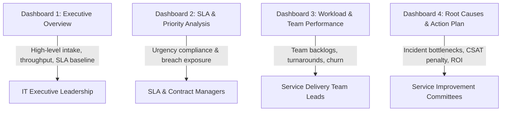

# Tableau Dashboard Architecture & Visualization Guide

**Workbook File:** [`tableau/ITSM_SLA_Intelligence_Platform.twb`](file:///Users/gitanshgarg/Documents/infosys/Enterprise-IT-Service-Desk-SLA-Intelligence/tableau/ITSM_SLA_Intelligence_Platform.twb)  
**Primary Engine:** Tableau Desktop 2026.2 (Apple Silicon) / Tableau Public  
**Data Source:** Federated connection to `data/cleaned/itsm_tickets_cleaned.csv`

---

## 1. Multi-Page Dashboard Architecture

The reporting layer is structured into **four executive dashboard pages**, each answering specific managerial and operational questions:

---

## 2. Page-by-Page Visual Specification

### Page 1: Executive Overview
- **Objective:** Give the Chief Information Officer (CIO) and Head of IT Service Delivery an instant, high-level pulse check of service health.
- **Components:**
  1. **Executive KPI Header:**
     - Total Ingested Tickets (`10,000`)
     - Resolved Tickets (`9,514` / `95.1%`)
     - Active Open Backlog (`486` / `4.9%`)
     - Contractual SLA Compliance (`82.31%`)
     - SLA Breaches (`1,683`)
     - Average Actual Turnaround (`24.77 hrs` vs `30.33 hrs` committed SLA)
  2. **Monthly Ticket Intake Trend (Line/Area Chart):**
     - Shows ticket seasonality across all 12 months (Oct 2025 to Sep 2026).
     - Highlights volume peaks (e.g., Oct 2025 at 967 tickets; May 2026 at 887 tickets).
  3. **Ticket Distribution by Priority (Donut / Horizontal Bar):**
     - Shows proportional volume by severity: Medium P3 (47.9%), Low P4 (23.4%), High P2 (20.4%), Critical P1 (8.3%).

---

### Page 2: SLA & Priority Analysis
- **Objective:** Deep-dive into contractual breach hotspots across urgency tiers and service domains.
- **Components:**
  1. **SLA Compliance Rate by Priority (Target Reference Bar Chart):**
     - Compares compliance across P1 (81.04%), P2 (82.76%), P3 (82.74%), and P4 (81.47%).
     - Proves that even with a tight 4-hour SLA window, Critical P1 maintains >81% compliance.
  2. **Total SLA Breaches by Category (Ranked Horizontal Bars):**
     - Breakdown of failures across the 5 domains: Network & Connectivity leads with 469 breaches, followed by Cloud & Infrastructure (367 breaches).
  3. **SLA Breach Rate % by Support Team (Heat-Styled Bars):**
     - Directly exposes that Network Operations carries a 27.75% breach rate, whereas Service Desk - Tier 1 has a low 13.95% breach rate.
  4. **Actual vs. Target Resolution Duration (Dual Measure Comparison):**
     - Visualizes the operational buffer between delivery speed and contractual SLA hours.

---

### Page 3: Workload & Team Performance
- **Objective:** Balance capacity, prevent engineer burnout, and eliminate queue congestion.
- **Components:**
  1. **Gross Ticket Intake by Support Team:**
     - Tier 1 Service Desk handles 3,920 tickets (39.2% of company total), followed by Cloud (1,828) and Network (1,645).
  2. **Active Open Backlog Queue by Priority (Stacked Bar):**
     - Slices the 486 active tickets by team and priority. Highlights that Tier 1 holds 220 open tickets (45.3% of total backlog).
  3. **Average Turnaround Duration by Group (Hours):**
     - Highlights operational bottlenecks: Network Operations takes 28.61 hrs average, while Tier 1 resolves tickets in 23.34 hrs.
  4. **Quality Churn Matrix (Reopened vs. Escalated Rates):**
     - Scatter/Dual bar showing Cloud (15.37%) and Network (14.71%) as the highest escalation groups, while Tier 1 experiences the highest reopen rate (6.00%).

---

### Page 4: Root Causes & Strategic Recommendations
- **Objective:** Translate data findings into actionable management decisions and future ROI.
- **Components:**
  1. **Top 10 Root-Cause SLA Breach Drivers (Category + Subcategory):**
     - Office Wi-Fi Access (132 breaches)
     - DNS & Gateway Routing (126 breaches)
     - Bandwidth & Latency (106 breaches)
     - LAN Cable & Port (105 breaches)
     - Proves that 4 Network subcategories alone drive 27.87% of all corporate SLA failures!
  2. **CSAT Impact by SLA Status (Side-by-Side Comparison):**
     - Visually portrays the steep drop in customer satisfaction: 4.25 / 5.0 for SLA Met vs 2.65 / 5.0 for SLA Breached (-1.60 point satisfaction drop).
  3. **Strategic Management Action Plan Matrix:**
     - 5 clear, low-cost interventions (Wi-Fi self-heal scripts, automated 75% SLA warning alerts, Tier 1 password self-service, Cloud runbooks, and 48-hour closure validation).

---

## 3. How to Open and Publish to Tableau Public

### Step 1: Open in Tableau Desktop
1. On your Mac, launch **Tableau Desktop (Apple silicon)** from `/Applications` or double-click [`tableau/ITSM_SLA_Intelligence_Platform.twb`](file:///Users/gitanshgarg/Documents/infosys/Enterprise-IT-Service-Desk-SLA-Intelligence/tableau/ITSM_SLA_Intelligence_Platform.twb).
2. Tableau will automatically read the relative path to `data/cleaned/itsm_tickets_cleaned.csv`.
3. All calculated fields, worksheets, and dashboard layouts will appear in the bottom tab bar.

### Step 2: Publish to Tableau Public (100% Free Portfolio Hosting)
1. Go to top menu: **Server > Tableau Public > Save to Tableau Public As...**
2. Sign in with your free Tableau Public account (create one at `public.tableau.com` if you don't have one).
3. Name your workbook: `Enterprise IT Service Desk & SLA Intelligence Platform`.
4. Click **Save**.
5. Tableau Public will publish the interactive workbook to the cloud and give you a public URL (e.g. `https://public.tableau.com/app/profile/yourname/viz/...`).
6. Add this interactive link directly to your **Resume** and **LinkedIn**!
