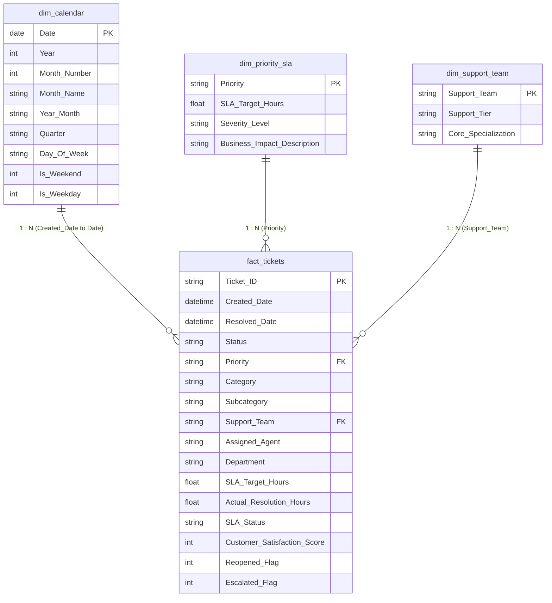

# Power BI Data Model & DAX Measure Architecture Guide

This guide details the complete data modeling architecture, Star Schema relationships, Power Query transformations, and production DAX measures designed for the **Enterprise IT Service Desk & SLA Intelligence Platform**.

---

## 1. Star Schema Architecture

The data model follows industry-standard dimensional modeling principles (Kimball methodology), placing the transactional ticket events in a central fact table surrounded by lookup dimensions.



### Relationship Design Principles:
1. **Cardinality:** All relationships are strictly `1:Many` (`1` on the dimension side, `Many` on the fact side).
2. **Filter Direction:** Single-direction filtering from dimensions down to `fact_tickets`. This ensures optimal performance and prevents ambiguous circular filter contexts.
3. **Primary / Foreign Keys:**
   - `dim_calendar[Date]` $\rightarrow$ `fact_tickets[Created_Date]` (truncated to date)
   - `dim_priority_sla[Priority]` $\rightarrow$ `fact_tickets[Priority]`
   - `dim_support_team[Support_Team]` $\rightarrow$ `fact_tickets[Support_Team]`

---

## 2. Production DAX Measures Library

Every measure is defined in a dedicated measures table `_KPI_Measures` using defensive programming (`DIVIDE` with `0` fallback) to prevent runtime divide-by-zero errors.

---

### Measure 1: Total Tickets
- **Definition:** Total count of all ticket incidents ingested into the IT service desk across all lifecycle states.
- **Business Purpose:** Establishes gross intake volume for capacity planning.
```dax
Total Tickets = 
COUNTROWS(fact_tickets)
```

---

### Measure 2: Resolved Tickets
- **Definition:** Count of tickets that have completed technical troubleshooting and are marked as either `Resolved` or `Closed`.
- **Business Purpose:** Measures operational throughput of the service organization.
```dax
Resolved Tickets = 
CALCULATE(
    COUNTROWS(fact_tickets),
    fact_tickets[Status] IN { "Resolved", "Closed" }
)
```

---

### Measure 3: Active Open Tickets (Backlog)
- **Definition:** Count of unresolved incidents currently active in support queues (`In Progress`, `Pending Customer`, or `New`).
- **Business Purpose:** Highlights queue congestion and unserviced operational liabilities.
```dax
Open Tickets = 
CALCULATE(
    COUNTROWS(fact_tickets),
    NOT(fact_tickets[Status] IN { "Resolved", "Closed" })
)
```

---

### Measure 4: Resolution Rate %
- **Definition:** Percentage of total ticket volume successfully completed.
- **Formula:** $\frac{\text{Resolved Tickets}}{\text{Total Tickets}}$
```dax
Resolution Rate % = 
DIVIDE(
    [Resolved Tickets],
    [Total Tickets],
    0
)
```

---

### Measure 5: SLA Eligible Tickets
- **Definition:** The baseline population of tickets eligible for formal contractual SLA audit. In standard ITIL reporting, **only resolved/closed tickets** are evaluated for finalized SLA compliance. Active open tickets cannot be audited for historical compliance until their lifecycle concludes.
```dax
SLA Eligible Tickets = 
[Resolved Tickets]
```

---

### Measure 6: SLA Met Tickets
- **Definition:** Completed tickets where actual turnaround duration was less than or equal to the committed SLA target hours (`Actual_Resolution_Hours <= SLA_Target_Hours`).
```dax
SLA Met Tickets = 
CALCULATE(
    COUNTROWS(fact_tickets),
    fact_tickets[Status] IN { "Resolved", "Closed" },
    fact_tickets[SLA_Status] = "Met"
)
```

---

### Measure 7: SLA Breaches
- **Definition:** Completed tickets where resolution duration exceeded the committed SLA threshold (`Actual_Resolution_Hours > SLA_Target_Hours`).
```dax
SLA Breaches = 
CALCULATE(
    COUNTROWS(fact_tickets),
    fact_tickets[Status] IN { "Resolved", "Closed" },
    fact_tickets[SLA_Status] = "Breached"
)
```

---

### Measure 8: SLA Compliance %
- **Definition:** Proportion of eligible resolved tickets completed within contractual SLA targets.
- **Critical Interview Note:** A common beginner error is dividing by `[Total Tickets]`. The correct ITIL denominator is strictly `[SLA Eligible Tickets]` (i.e. resolved tickets).
- **Formula:** $\frac{\text{SLA Met Tickets}}{\text{SLA Eligible Tickets}}$
```dax
SLA Compliance % = 
DIVIDE(
    [SLA Met Tickets],
    [SLA Eligible Tickets],
    0
)
```

---

### Measure 9: SLA Breach Rate %
- **Definition:** Proportion of eligible resolved tickets that failed contractual commitments.
- **Formula:** $\frac{\text{SLA Breaches}}{\text{SLA Eligible Tickets}}$
```dax
SLA Breach Rate % = 
DIVIDE(
    [SLA Breaches],
    [SLA Eligible Tickets],
    0
)
```

---

### Measure 10: Average Actual Resolution Hours
- **Definition:** Mean calendar hours required to resolve completed tickets.
- **Eligible Population:** Resolved / Closed tickets only (open tickets carry `BLANK()` hours to avoid skewing averages).
```dax
Average Resolution Hours = 
CALCULATE(
    AVERAGE(fact_tickets[Actual_Resolution_Hours]),
    fact_tickets[Status] IN { "Resolved", "Closed" }
)
```

---

### Measure 11: Average SLA Target Hours
- **Definition:** Mean contractual benchmark committed across the resolved population.
```dax
Average SLA Target Hours = 
CALCULATE(
    AVERAGE(fact_tickets[SLA_Target_Hours]),
    fact_tickets[Status] IN { "Resolved", "Closed" }
)
```

---

### Measure 12: Turnaround Buffer (Variance Hours)
- **Definition:** Difference between contractual target and actual delivery speed. Positive values indicate a healthy buffer; negative values indicate system-wide breaches.
```dax
Turnaround Buffer Hours = 
[Average SLA Target Hours] - [Average Resolution Hours]
```

---

### Measure 13: Average Customer Satisfaction (CSAT)
- **Definition:** Arithmetic mean of post-resolution survey scores (1.0 to 5.0 scale). Unresponded surveys (`BLANK()`) are automatically excluded from the denominator.
```dax
Average Customer Satisfaction = 
AVERAGE(fact_tickets[Customer_Satisfaction_Score])
```

---

### Measure 14: Reopened Tickets & Reopened Rate %
- **Definition:** Tickets that required secondary intervention after initial resolution.
- **Denominator Rule:** Reopened rate is evaluated against resolved incidents ($\frac{\text{Reopened}}{\text{Resolved}}$).
```dax
Reopened Tickets = 
SUM(fact_tickets[Reopened_Flag])

Reopened Rate % = 
DIVIDE(
    [Reopened Tickets],
    [Resolved Tickets],
    0
)
```

---

### Measure 15: Escalated Tickets & Escalation Rate %
- **Definition:** Incidents routed to secondary engineering tiers or senior management.
- **Denominator Rule:** Escalation rate is evaluated across total intake volume ($\frac{\text{Escalated}}{\text{Total}}$).
```dax
Escalated Tickets = 
SUM(fact_tickets[Escalated_Flag])

Escalation Rate % = 
DIVIDE(
    [Escalated Tickets],
    [Total Tickets],
    0
)
```

---

## 3. Power Query M-Code Transformation Template

When ingesting `itsm_tickets_cleaned.csv` into Power BI Desktop via Power Query:

```powerquery
let
    Source = Csv.Document(File.Contents("data/cleaned/itsm_tickets_cleaned.csv"), [Delimiter=",", Columns=16, Encoding=65001, QuoteStyle=QuoteStyle.None]),
    #"Promoted Headers" = Table.PromoteHeaders(Source, [PromoteAllScalars=true]),
    #"Changed Type" = Table.TransformColumnTypes(#"Promoted Headers",{
        {"Ticket_ID", type text},
        {"Created_Date", type datetime},
        {"Resolved_Date", type datetime},
        {"Status", type text},
        {"Priority", type text},
        {"Category", type text},
        {"Subcategory", type text},
        {"Support_Team", type text},
        {"Assigned_Agent", type text},
        {"Department", type text},
        {"SLA_Target_Hours", type number},
        {"Actual_Resolution_Hours", type number},
        {"SLA_Status", type text},
        {"Customer_Satisfaction_Score", Int64.Type},
        {"Reopened_Flag", Int64.Type},
        {"Escalated_Flag", Int64.Type}
    }),
    #"Inserted Date Key" = Table.AddColumn(#"Changed Type", "Created_Date_Key", each DateTime.Date([Created_Date]), type date)
in
    #"Inserted Date Key"
```
